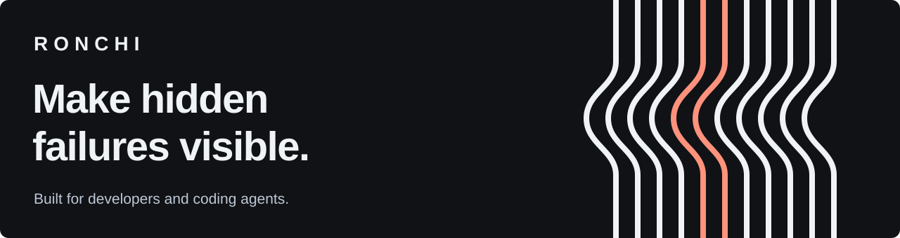
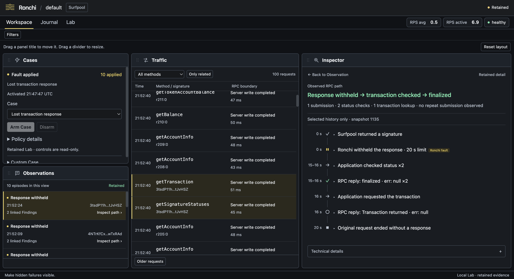
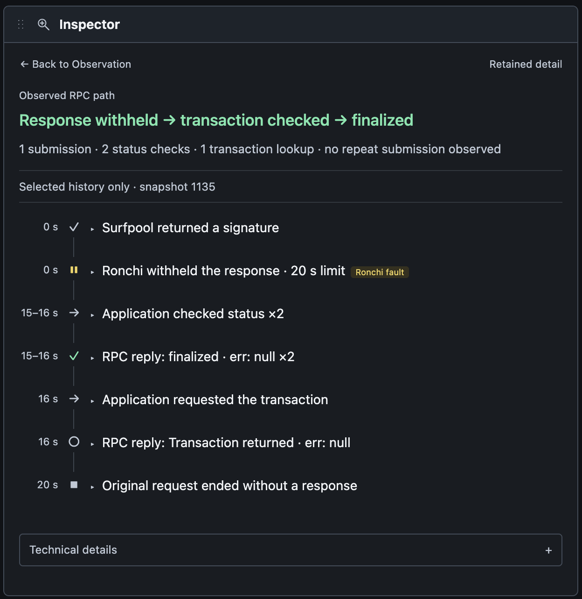
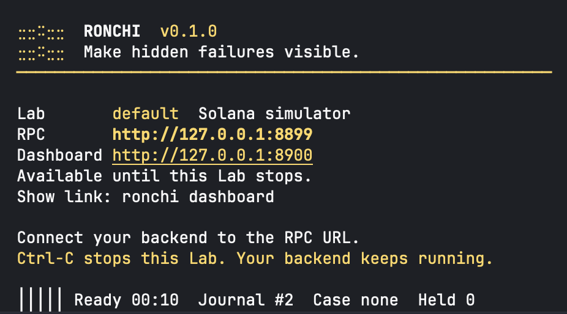

<p align="center">
  
</p>

<p align="center">
  <strong>A local reliability lab for Solana backends.</strong><br>
  Controlled RPC failures. Live traffic. Evidence you can inspect.
</p>

<p align="center">
  <a href="#quickstart">Quickstart</a> ·
  <a href="#built-for-coding-agents">Coding agents</a> ·
  <a href="docs/README.md">Documentation</a>
</p>

Your RPC request timed out. Was the transaction accepted? Did your backend check the original signature or submit again?

Ronchi makes that behavior visible. Start a local Lab, point your backend at its RPC URL, and activate a Case. Watch the requests, the injected fault and the backend's next actions in one place.

**Open source · Local-first · No account or cloud required · No application SDK required**



*Retained Surfpool session: one selected submission, a withheld response, two status checks and one transaction lookup. Both status replies report `finalized` with `err: null`. Screenshots show the current source build.*

## One Lab. Two ways to investigate.

| For you | For your coding agent |
| --- | --- |
| A live Workspace with Cases, Traffic, Observations and Inspector. | Structured CLI output and a local MCP server. |
| Select an Observation to follow its path and inspect the actual RPC replies. | Start with a summary, narrow by signature or method, then request supporting evidence. |
| Move and resize the panels. Open Journal for the full history. | Use bounded pages and field selection to keep context small. |

Both interfaces read the **same Lab Journal**. The dashboard updates over a live WebSocket. Findings link to recorded evidence. The Journal remains available after the Lab stops.

## From a missing response to an explained incident

With `tx-response-lost`, Ronchi withholds the response after acceptance. Your backend sees an ambiguous submission. Its subsequent RPC calls reveal how it reacts.

<p align="center">
  
</p>

In this captured history:

- Surfpool returned a signature for **one submission**.
- Ronchi withheld the submission response for **20 seconds**. The original request ended without a response.
- The application made **two status checks** for the same signature. Both replies reported `finalized` with `err: null`.
- The application requested the transaction once. That RPC reply returned the transaction with `err: null`.
- **No repeat submission** of that signature appeared in the selected history.

Expand **Technical details** for identifiers, supporting events and retained RPC payloads. Each path step keeps its evidence links.

These replies establish observed RPC behavior. They do not prove that the backend completed its business operation. The default Simulator does not execute transfers.

## Built for coding agents

AI-native means your coding agent can operate the Lab and investigate its evidence directly. Ronchi does not need an embedded model or a hosted AI service.

Use structured commands from the project directory:

```bash
ronchi case arm tx-response-lost --json
ronchi investigate summary --json
ronchi investigate findings --limit 10 --json
```

Once you have a signature, narrow the investigation:

```bash
ronchi investigate requests --signature "$SIGNATURE" --limit 20 --json
ronchi investigate evidence --signature "$SIGNATURE" \
  --fields kind,source,transaction_signature --limit 20 --json
```

Set `SIGNATURE` to a signature from your Lab. Responses carry evidence references and completeness metadata. Use `--cursor` for the next page and `--include-payload` when the actual retained payload is needed.

For an MCP-capable coding agent, configure this local stdio command with an absolute project path:

```bash
ronchi --project /absolute/path/to/your-project mcp stdio
```

The MCP tools cover Lab lifecycle, Case controls and investigation. For example, `ronchi_investigate_summary`, `ronchi_investigate_findings` and `ronchi_investigate_evidence` expose the same query core as the CLI.

A useful agent request:

> Investigate the latest response-loss incident. Show what Ronchi applied, what RPC calls followed for the original signature, and which status replies were returned. Cite the evidence. Keep unknown application behavior explicit.

See the [CLI/MCP contract](docs/product/investigation-interfaces.md) for schemas, filters, limits and errors.

## Quickstart

### Native installer

The curl installer installs Ronchi together with its pinned private Surfpool. You do not need Rust, Node.js or a separate Surfpool installation.
**Public installation pending:** [v0.1.0](https://github.com/kirillermakovichh/ronchi/releases/tag/v0.1.0) has passed native build and installation checks. Anonymous downloads remain unavailable while the repository is private. Use the source build below until public downloads are enabled.

When public downloads are enabled, install with:

```bash
curl --proto '=https' --tlsv1.2 -fsSL \
  https://github.com/kirillermakovichh/ronchi/releases/latest/download/install.sh | sh
```

Run the same command to update. The installer keeps old releases for running Labs and prints a PATH instruction if needed. It does not edit your shell profile automatically.
Journals and Lab state remain in each project's `ronchi/` directory. See [installation layout and removal](docs/development.md#curl-installation-layout).

### Build from source

You need the [pinned Rust toolchain](rust-toolchain.toml), a platform C compiler/linker, Node.js and npm. Run these commands from this checkout:

```bash
npm --prefix dashboard ci
npm --prefix dashboard run build
cargo build --release --locked
```

Add the built executable to your current shell's PATH:

```bash
export PATH="$PWD/target/release:$PATH"
```

Build the dashboard before the native executable. The executable embeds the dashboard assets. Running a Lab requires no Node process or Docker.

### Try the bundled incident

```bash
ronchi demo tx-response-lost
```

Demo starts an isolated Simulator Lab and a bundled reference relayer. It applies response loss and records the relayer's RPC behavior. The result includes a dashboard launch link and investigation commands. The relayer stops when Demo finishes; the Lab stays available.

To show its dashboard link again, use the exact `lab_id` from the result:

```bash
ronchi --lab-id "$LAB_ID" dashboard
```

Set `LAB_ID` to that result's ID. Stop this Demo Lab when finished:

```bash
ronchi --lab-id "$LAB_ID" down
```

### Connect your own backend

From your backend's project directory:

```bash
ronchi up
```



*Foreground Simulator Lab with local RPC and dashboard addresses. Ctrl-C stops the Lab. Interactive startup animates by default.*

1. Open the dashboard link printed in the terminal.
2. Set your backend's Solana RPC URL to Ronchi's printed RPC URL.
3. Start your backend in another terminal.
4. Arm **Lost transaction response** in Cases.
5. Trigger a transaction through your backend.
6. Select the resulting Observation to inspect its path and related Traffic.

You can arm the same continuing Case from another terminal in the same project:

```bash
ronchi case arm tx-response-lost
```

A Case stays active until you disarm it, replace it or stop the Lab. Switching Cases preserves the Journal.

**Ctrl-C stops Ronchi. Your backend keeps running.** The dashboard link remains valid while its Lab runs. `ronchi dashboard` shows the link again. Use `ronchi up --detach` when you explicitly want a background Lab.

If a default port is occupied, select free loopback ports:

```bash
ronchi up --rpc-listen 127.0.0.1:0 --control-listen 127.0.0.1:0
```

## Choose the local environment

| | Simulator — default | Managed Surfpool — optional |
| --- | --- | --- |
| Best fit | Submission, signature tracking, retries and ambiguous RPC outcomes. | Workflows that need local program execution and account state. |
| Behavior | Models transaction lifecycle and blockhash validity. Does not execute programs or change balances. | Sends supported reads and writes through local Surfpool. |
| Existing chain data | Optional allowlisted Read Upstream; transactions and unknown methods are never forwarded. | Surfpool can load programs and accounts from its datasource. Required state must exist or be prepared. |

For local execution with an explicitly selected datasource:

```bash
ronchi up --mode surfpool \
  --surfpool-datasource https://api.mainnet-beta.solana.com
```

Packaged installations already include Surfpool. Source builds need the explicit pinned-archive setup described in the link below. Transactions execute locally in this mode. Ronchi does not fund signers or request airdrops. See [Surfpool setup and limits](docs/product/lab-lifecycle.md#managed-native-surfpool-implementation).

## Explore other failure patterns

The catalog covers five initial families:

| Failure | What to look for |
| --- | --- |
| RPC unavailable or timeout | Retry behavior during an outage and after recovery. |
| Lost submission response | Tracking of the original signature after an ambiguous send. |
| Missing or stale status | Reactions to unavailable or older transaction views. |
| Stalled confirmation | Behavior when a transaction does not reach the expected commitment. |
| Expired blockhash | Rebuilding and resubmission after validity expires. |

Use `ronchi case list` to see the current catalog and mode support. [Custom Cases](docs/product/custom-cases.md) compose supported primitives and Finding rules in bounded YAML. They do not run arbitrary executable plugins.

## Scope and status

Ronchi is a **local investigation prototype**. Commands, schemas and configuration may change. Compatibility is bounded by the [Solana RPC contract](docs/product/solana-rpc-contract.md); Ronchi does not implement every Solana method or emulate mainnet.

Use it in **local development, CI or isolated staging**. Never place Ronchi between a production application and its production RPC.

The traffic boundary is Solana **HTTP JSON-RPC**. Blockchain WebSocket, multi-provider routing, Jito and EVM are outside current scope. The dashboard's live WebSocket is a separate UI connection.

Ronchi explains observed behavior. It does not infer business intent, equate two signatures with two transfers, or evaluate application business requirements. Findings state their evidence and limitations.

## Go deeper

- [Developer workflows](docs/product/workflows.md) — connect, apply a Case and investigate.
- [Dashboard](docs/product/dashboard.md) — Workspace, live updates and retained history.
- [Cases and coverage](docs/product/cases.md) — exact fault behavior and verified boundaries.
- [Development](docs/development.md) — stack, build, tests and contribution workflow.
- [Documentation map](docs/README.md) — product contracts, decisions and domain glossary.
- [Agent instructions](AGENTS.md) — project rules and skill routing.
- [Development queue](tasks/todo.md) — completed work and remaining validation.

Ronchi is available under the [MIT license](LICENSE). Surfpool and other bundled dependencies retain their own licenses and notices.
